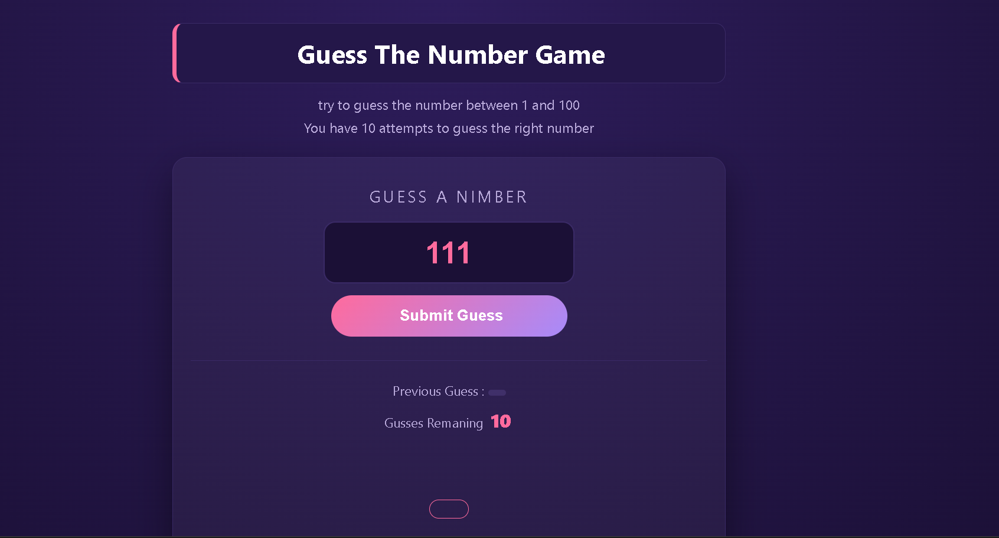
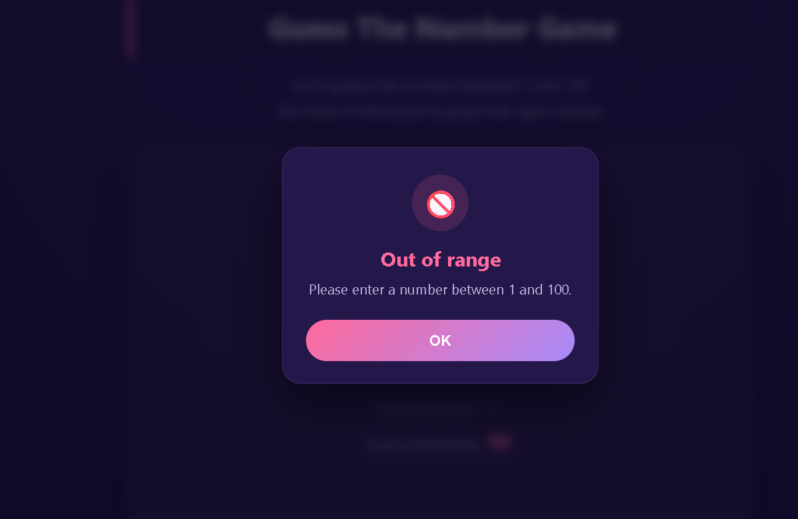

# Guess The Number Game

A browser game where the computer picks a random number between 1 and 100, and you have 10 attempts to guess it. After each guess, the game tells you whether to go higher or lower.

## Screenshot




## How to Play

1. Enter a number between 1 and 100.
2. Click **Submit Guess**.
3. The game tells you if your guess is too low or too high.
4. You win if you find the number within 10 attempts. Otherwise, the game ends and shows the correct answer.

## Features

- Random number generated each game
- Input validation: rejects empty values, numbers outside 1 to 100, and non-numeric input
- Tracks your previous guesses and remaining attempts
- Disables the input when the game ends
- Responsive layout that works on desktop and mobile

## How to Run

1. Clone the repository:
   ```bash
   git clone https://github.com/abdallaahemd/Guess-The-Number.git
   ```
2. Open the project folder.
3. Open `index.html` in your browser.

## Project Structure

```
Guess-The-Number/
├── index.html      # Game layout
├── style.css       # Game styles
├── main.js         # Game logic
└── screenshots/    # Screenshots used in this README
```

## What I Learned

- Generating random numbers with `Math.random()`
- Handling click events and preventing form submission with `preventDefault()`
- Validating user input with `isNaN()` and range checks
- Updating the page with `innerHTML` and `textContent`
- Disabling and re-enabling an input field

## Built With

- HTML
- CSS
- JavaScript

## Author

**Abdallah Ahmed**: Programming instructor and developer
- LinkedIn: https://www.linkedin.com/in/abdalla-konsowa-386414203
- itch.io: https://abdallak.itch.io/
